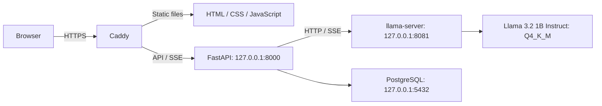

# Resource-constrained Llama inference

A **self-hosted Llama inference application designed for a CPU-only VPS**, with
streaming chat, persistent conversations, resource controls, and reproducible
benchmarks. It serves **Meta Llama 3.2 1B Instruct** using llama.cpp, FastAPI,
vanilla JavaScript, and PostgreSQL. The same application can alternatively run
on a compatible local Linux machine.

**Implemented and tested on the reference VPS through Phase 5; public deployment
is prepared but unexecuted.** Current access uses loopback HTTP or an SSH tunnel.
Dockerization is outside the final scope.

## Architecture

The intended public VPS topology is:



Currently FastAPI also serves the frontend, accessed through an SSH tunnel to
the VPS or directly on a local machine. Caddy's public HTTPS role is prepared.

- **llama-server** loads weights once and performs CPU inference in a separate
  process; FastAPI connects to that process for each request.
- **FastAPI** validates requests, streams output, handles cancellation, and
  persists state through SQLAlchemy with Alembic schema migrations.
- **PostgreSQL** persists anonymous sessions, messages, completed/failed/cancelled
  states, and request metrics. A browser cookie controls access to its history.
- The **public profile** adds Secure cookies, same-origin checks, rate limits,
  durable daily quotas, and one active generation with two FIFO waiters. Backend,
  model, and database ports stay private.

Defaults: Q4_K_M weights, FP16 KV, four CPU threads, one native slot, 4,096 context
tokens, and 1,024 output tokens (maximum 2,048). Prefix reuse is disabled;
experimental settings do not replace these defaults.

## VPS requirements and local compatibility

| Component | Reference configuration |
| --- | --- |
| Operating system | Ubuntu 26.04 LTS |
| CPU | 6 vCPUs; measured on Intel Xeon Platinum 8272CL |
| Memory | 16 GB RAM |
| Storage target | 100 GB NVMe, including runtime builds, models, database, and backups |
| GPU | None; inference is CPU-only |
| Python environment | Miniconda, environment `llama`, Python 3.11 |
| Database | PostgreSQL 18 |
| Native build tools | Git, CMake, a C++ compiler, and Make |
| Intended public entry | Caddy with a domain and HTTPS |

These are reference targets, not minimum requirements. A local Linux machine
needs the same dependencies and a runtime built for its CPU; other OS/CPU
combinations are unvalidated. Node.js is only a development test runner.

## Setup on the VPS or a local machine

Run commands from the repository root. This prepares private operation.

### Python environment

```bash
conda env create -f environment.yml
conda activate llama
```

[`environment.yml`](environment.yml) pins conda-forge dependencies and excludes
default channels with `nodefaults`. It is the dependency source of truth.

The reference VPS's Conda terms plugin blocked this path through globally
configured default channels. This tested fallback avoids those channels without
changing global settings or accepting their terms:

```bash
conda create --override-channels -c conda-forge -n llama python=3.11 -y
conda install --override-channels -c conda-forge -n llama \
  httpx=0.28.1 pytest=9.1.1 ruff=0.17.1 anyio=4.16.0 \
  fastapi-core=0.162.2 uvicorn=0.54.0 pydantic=2.14.3 nodejs=24.22.1 \
  sqlalchemy=2.0.54 alembic=1.20.1 psycopg=3.3.8 -y
conda activate llama
```

Choose one creation method; see [Conda's environment guide](https://docs.conda.io/projects/conda/en/stable/user-guide/tasks/manage-environments.html).

### Model access and verification

Before downloading, personally review and accept the access terms on the
[official model page](https://huggingface.co/meta-llama/Llama-3.2-1B-Instruct)
and review the [Llama 3.2 Community License](legal/LLAMA-3.2-LICENSE.txt).

```bash
python -m inference.setup --jobs 3 --accept-llama-license
python -m inference.setup --verify-only
```

The flag attests to your acceptance; it does not accept terms for you. Setup
builds/reuses the CPU runtime and verifies the GGUF size, SHA-256, architecture,
tokenizer, and chat template against [pinned revisions](inference/artifacts.lock.json).
Weights, builds, and logs stay under ignored `.runtime/`. See the
[running guide](docs/02-running-llama.md) for details.

### Database setup

Follow [database setup](docs/07-database-design.md#local-setup) to provision the
application database and roles. A separate database whose name ends in `_test`
is required only for database integration tests and stack experiments.

Create an ignored, mode-`0600` `.runtime/database.env` with exported
`LLAMA_DATABASE_URL` and, for tests, `LLAMA_TEST_DATABASE_URL`. This private file
is not supplied by a fresh checkout. Use distinct credentials and loopback URLs
as documented in [.env.example](.env.example); files are not auto-loaded.

With the backend stopped, explicitly apply the schema:

```bash
source .runtime/database.env
alembic upgrade head
```

For an existing database, take a checked backup before migration; see
[operations and recovery](docs/11-operations-and-troubleshooting.md). Startup does
not create or migrate tables. Keep `LLAMA_PUBLIC_ORIGIN` unset and Secure cookies
disabled for the private HTTP workflow; the public profile requires HTTPS.

## Run the local web application

This private workflow works on the VPS and on a compatible local machine.
Activate `llama` in each terminal. In terminal 1, start the model process:

```bash
python -m inference.server
```

Keep it running. In terminal 2, start the backend:

```bash
source .runtime/database.env
python -m backend
```

On the same machine, open **http://127.0.0.1:8000**. For a VPS, run the following
on your own computer, targeting the VPS where those processes are running:

```bash
ssh -N -o ExitOnForwardFailure=yes -L 8000:127.0.0.1:8000 USER@VPS_HOST
```

Keep the tunnel open and visit **http://127.0.0.1:8000** on your computer. If local
port 8000 is occupied, use `-L 18000:127.0.0.1:8000` and browse local port 18000.
Server-side ports remain on loopback; this is private access.

Responses stream progressively; Stop Generation cancels the request. Refresh
restores conversations for the same browser cookie; clearing it loses access.
Use one backend worker/instance for admission and recovery. Ctrl+C stops each
foreground application service; PostgreSQL remains separate.
`GET /health` checks backend liveness; `/ready` checks the required database
schema and native model health.

## Deployment scope and intended workflow

| Implemented and validated on the VPS | Prepared; public execution remains pending |
| --- | --- |
| CPU model loading, generation, streaming, and cancellation | Domain/DNS and CA-issued public HTTPS |
| Browser frontend, anonymous sessions, and persistent conversations | Installation/enabling of production Caddy and systemd units |
| API security, quotas, rate limits, queueing, and failure handling | Host/provider firewall validation from outside the VPS |
| Temporary, certificate-verified loopback HTTPS through Caddy to FastAPI, PostgreSQL, and the model | Installed-service restart/resource-ceiling checks and production recovery drills |
| Isolated test-database migration and dump/restore checks | Review/application of deployment migrations, runtime grants, and private production configuration |

Loopback HTTPS tests used temporary certificates and isolated test schemas. They
do not establish a public installation or a clean-machine setup test. Browser
visual layout was not automated; see [recorded outcomes](docs/project-status.md).

For a future public VPS deployment, follow the
[manual deployment guide](docs/09-deployment-guide.md):

1. Supply a domain, ACME email, and monitored abuse contact; review the bundled
   license/use policy and required model attribution.
2. Stage a reviewed release and Conda environment under `/opt/llama`, with
   dedicated nonroot service users and private configuration.
3. Back up PostgreSQL, review/apply migrations, and grant the backend a separate
   least-privilege runtime role.
4. Install and validate the prepared Caddy/systemd files, then start the private
   services and confirm readiness.
5. Review firewall rules while preserving SSH; expose only Caddy on TCP 80/443,
   keeping ports 5432/8000/8081/2019 private.
6. Verify public HTTPS, streaming, cancellation, persistence, restart/recovery,
   and backups before enabling services at boot.

[`deploy/`](deploy/) contains the proxy, service, environment, grants, and backup
files. [Security/resource management](docs/10-security-and-resource-management.md)
and [operations/troubleshooting](docs/11-operations-and-troubleshooting.md) explain
the controls and operator checks. Prepared CPU/RAM ceilings were not active during
the inference benchmarks; remeasure under them before making capacity promises.
**No public deployment has been executed as part of this project.**

## Verify and reproduce benchmarks

```bash
ruff check .
ruff format --check .
pytest
pytest --run-inference
# Explicit database work uses a dedicated test database:
source .runtime/database.env
unset LLAMA_DATABASE_URL
pytest --run-database
pytest --run-database --run-inference
```

Ordinary tests use neither PostgreSQL nor loaded model weights. Proxy checks can
start a temporary loopback Caddy when a test binary is available; otherwise they
report skips. Select one with `LLAMA_TEST_CADDY=/path/to/caddy`. Database tests
refuse names without `_test` and migrate/drop only their own temporary schemas.
Real model tests require verified local assets and own temporary model servers.

Recorded Phase 5 validation on 2026-11-10: **389 ordinary tests passed with 51
intentional skips; 440 passed with database and real inference enabled**. See
[saved verification/JUnit evidence](docs/evidence/phase5-verification.json); these
tests were not rerun for this documentation update.

Run the existing serial baseline separately from other model workloads:

```bash
python -m benchmarks.scripts.run --config benchmarks/configs/smoke.json
python -m benchmarks.scripts.run --config benchmarks/configs/baseline.json
```

Benchmarks own their processes and save new results under ignored
`benchmarks/results/local/`. The [Phase 5 methodology](docs/13-benchmark-methodology.md)
provides Q4/Q8 verification, native sweep, cache-probe, prefix-reuse, and full-stack
experiment commands. The original [Llama baseline](docs/03-baseline-benchmark.md)
and explicitly [historical Qwen results](docs/03-qwen-historical-benchmark.md)
remain separate and preserved.

## Measured performance findings

The [curated Phase 5 run](benchmarks/results/2026-11-10-phase5/README.md) retains
18 native profiles and HTTPS stack measurements, with raw records, configurations,
outputs, tables, charts, and source hashes.

| Experiment | Recorded observation |
| --- | --- |
| Q4_K_M vs Q8_0 short decode | 21.19 vs 11.30 tokens/s; eight-case toy quality: 4/8 vs 5/8 |
| KV allocation at 2,048-token context | f16: 64 MiB; q8_0: 34 MiB; q4_0: 18 MiB |
| Repeated long-prefix TTFT | 2.273 → 0.052 s, confirmed by 309 reused native tokens |
| Four native clients | Continuous batching: 31.31 vs serial: 17.82 output tokens/s, with higher memory allocation |

These are small synthetic x86 VPS experiments, not Qualcomm/NPU measurements or
public-service guarantees. Control drift and a six-thread outlier limit causal
claims. [Performance findings](docs/16-performance-findings.md) explain the
trade-offs and why active serving defaults remain conservative; cache precision,
prefix reuse, and multi-slot experiments are not all enabled in the application.

## Documentation and repository map

| Area | Entry points |
| --- | --- |
| Inference setup and lifecycle | `inference/`; [fundamentals](docs/01-inference-fundamentals.md), [running Llama](docs/02-running-llama.md) |
| Backend and streaming | `backend/`; [architecture](docs/04-fastapi-architecture.md), [HTTP streaming](docs/05-http-streaming.md) |
| Browser behavior | `frontend/`; [frontend/backend communication](docs/06-frontend-backend-communication.md) |
| Persistence | [database design](docs/07-database-design.md), [sessions/API](docs/08-sessions-and-persistence.md) |
| Deployment and operations | `deploy/`; [deployment](docs/09-deployment-guide.md), [security](docs/10-security-and-resource-management.md), [operations](docs/11-operations-and-troubleshooting.md) |
| Efficient inference | [fundamentals](docs/12-efficient-ai-fundamentals.md), [methodology](docs/13-benchmark-methodology.md), [quantization](docs/14-quantization-experiments.md), [cache/concurrency](docs/15-cache-and-concurrency.md) |
| Measurements and decisions | `benchmarks/`; [baseline](docs/03-baseline-benchmark.md), [model ADR](docs/decisions/0002-llama-model-migration.md), [Phase 5 findings](docs/16-performance-findings.md) |
| Tests and project scope | `tests/`; [current status](docs/project-status.md), [specification](PROJECT_SPEC.md) |
