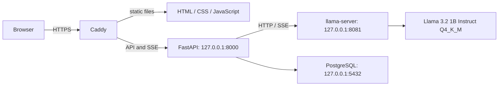
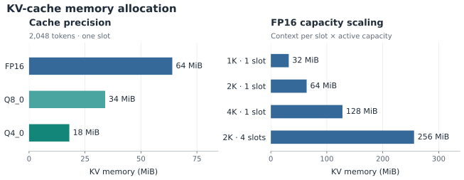
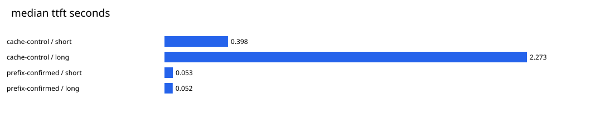

# Llama Inference

## Overview and objectives

A CPU-only, self-hosted Llama chat application for a VPS, with local Linux as an alternative. It combines streaming inference, persistent anonymous conversations, bounded resource use, and reproducible performance experiments. The active model is **Meta Llama 3.2 1B Instruct**, served by llama.cpp with Q4_K_M weights.

## Architecture



Caddy is the public HTTPS entry; inference, backend, and database stay on loopback. For private access, FastAPI also serves the frontend directly through localhost or an SSH tunnel. A single backend worker manages admission, streaming, cancellation, and persistence. See [architecture and security](docs/architecture.md).

## Repository structure

```text
inference/     Pinned model/runtime setup and native server lifecycle
backend/       FastAPI, streaming, persistence, migrations and controls
frontend/      Browser chat interface
deploy/        Caddy, systemd, environment and backup templates
benchmarks/    Experiment configurations, scripts and curated measurements
docs/          Running, deployment, operations and benchmark guides
legal/         Model license, use policy and attribution
tests/         Unit, integration and opt-in live tests
```

## Technical stack

| Component | Technology |
| --- | --- |
| Model and inference | Meta Llama 3.2 1B Instruct, GGUF Q4_K_M, CPU llama.cpp |
| API and streaming | Python 3.11, FastAPI, HTTPX, server-sent events |
| Persistence | PostgreSQL 18, SQLAlchemy 2, Alembic, psycopg 3 |
| Frontend | HTML, CSS and vanilla JavaScript |
| VPS entry and processes | Caddy HTTPS and systemd templates |
| Environment and tests | Conda, pytest, Ruff |

Defaults are four inference threads, one native slot, 4,096 context tokens, f16 KV cache, and 1,024 output tokens (maximum 2,048). Prefix reuse is disabled. The public profile bounds work to one active generation and two FIFO waiters.

## Performance

Measured on a six-vCPU Intel Xeon Platinum 8272CL VPS with 16 GB RAM, using the pinned CPU runtime and fixed synthetic prompts. The native sweep included 18 profiles and 232 successful requests (58 warm-ups and 174 measured). These comparisons use experimental configurations, not all application defaults.

| Comparison | Observation |
| --- | --- |
| Q4_K_M vs Q8_0, short-prompt decode | 21.19 vs 11.30 tokens/s; toy exact-match quality 4/8 vs 5/8 |
| KV allocation, 2,048-token context | f16: 64 MiB; q8_0: 34 MiB; q4_0: 18 MiB |
| Repeated long-prefix median time to first token | 2.273 → 0.052 s, with 309 tokens reused |
| Four native clients, continuous batching vs serial | 31.31 vs 17.82 output tokens/s; batching used more memory |

Weight comparisons use four threads, 2,048 context tokens, a 32-token output cap,
temperature 0, seed 42, and three measured repetitions after warm-up. Prefix results
measure warm reuse. Multi-slot comparisons hold context per slot constant, increasing
total allocated context.





[Methodology, controls and reproduction](docs/benchmarks.md) · [Raw measurements and charts](benchmarks/results/2026-11-10-phase5/README.md)

## Quick start

Install Conda, PostgreSQL 18 and the native build tools on a compatible Linux VPS or local machine. Personally review and accept the [official model access terms](https://huggingface.co/meta-llama/Llama-3.2-1B-Instruct) and [license](legal/LLAMA-3.2-LICENSE.txt) before obtaining weights. Then, from the repository root:

```bash
conda env create -f environment.yml
conda activate llama
python -m inference.setup --jobs 3 --accept-llama-license
python -m inference.setup --verify-only
```

Provision the database and private environment file using the [running guide](docs/running.md), then migrate explicitly:

```bash
source .runtime/database.env
alembic upgrade head
```

Run the model and backend in separate foreground terminals, activating `llama` in each:

```bash
# Terminal 1
python -m inference.server
```

```bash
# Terminal 2
source .runtime/database.env
python -m backend
```

Open http://127.0.0.1:8000 on the host. To access a VPS privately, run this on your own computer, keep it open, and visit the same localhost URL:

```bash
ssh -N -o ExitOnForwardFailure=yes -L 8000:127.0.0.1:8000 USER@VPS_HOST
```

For public HTTPS, follow the [manual VPS deployment guide](docs/deployment.md) and [operations guide](docs/operations.md). They cover dedicated service users, migration and runtime roles, Caddy, firewall boundaries, backups, and recovery.

## Benchmarking and testing

```bash
ruff check .
ruff format --check .
pytest
pytest --run-inference
# Requires a dedicated database ending in _test:
source .runtime/database.env
unset LLAMA_DATABASE_URL
pytest --run-database --run-inference
```

Ordinary tests do not load model weights or use PostgreSQL; real inference and database tests are opt-in. Proxy tests may skip if Caddy is unavailable. Live tests require verified local assets and a dedicated test database; database fixtures use isolated schemas. The [benchmark guide](docs/benchmarks.md) provides experiment commands, configuration, and interpretation.

## Limitations and license

The measurements use one host, fixed prompts, small sample sizes and warm OS pages; the four-thread control drifted 13.5% across the sweep. Toy exact-match scores do not establish general model quality. Systemd CPU ceilings and internet latency were not included in the measurements; remeasure under actual deployment constraints. Anonymous cookie sessions have no account recovery, and clearing the cookie loses access. One backend worker is required for queue and recovery ownership.

Review the [Llama 3.2 Community License](legal/LLAMA-3.2-LICENSE.txt), [Acceptable Use Policy](legal/LLAMA-3.2-USE-POLICY.md), and attribution requirements before use or distribution.
