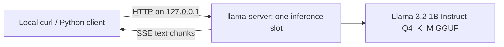
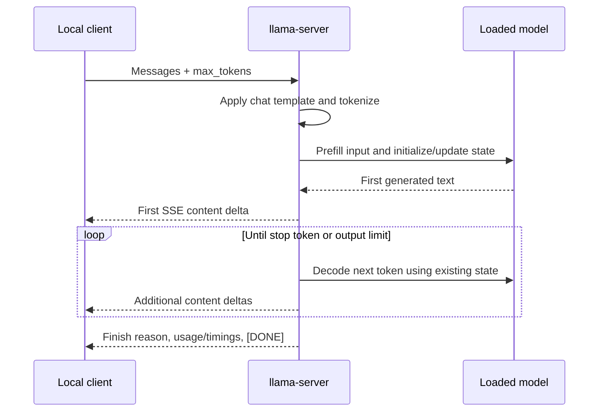

# 01 — Inference fundamentals

Our first milestone is a program that loads one model and answers local HTTP
requests. Before adding a web application, we need to know whether this expensive
component works, how much memory it uses, and where request time goes. The pinned Llama
artifact is now downloaded and verified after Tommy confirmed license/access
acceptance. Real generation, streaming, tokenization, and template checks pass;
the baseline report records measured performance separately.



`inference/config.py` defines the runtime settings. `inference/server.py` handles
foreground execution and temporary process ownership. `benchmarks/scripts/run.py`
performs serial requests and records their measurements. No Python code in this
phase implements neural-network operations; that work belongs to llama.cpp.

## From text to the next token

A language model predicts a distribution over the **next token** given the tokens
already seen. A token is an entry in a fixed vocabulary. It can represent a word,
part of a word, punctuation, or other byte sequences. Consequently, splitting text
on spaces does not count model tokens, and an SSE chunk does not equal a token.

The **tokenizer** turns text into integer token IDs and converts generated IDs
back into text. Llama 3 uses 128,256 vocabulary entries and Llama BPE
pre-tokenization. Tokenization rules must match training: using another model's
tokenizer can produce syntactically valid integers with the wrong meaning. The
opt-in live test checks `/tokenize` and `/detokenize`;
it does not approximate token counts with Python string operations.

Chat requests also need a **chat template**. This serializes roles and messages
into the exact input structure expected by the model. The Llama 3 template uses
markers including `<|begin_of_text|>`, `<|start_header_id|>`,
`<|end_header_id|>`, and `<|eot_id|>`. The conversion embeds a Jinja
template; `--jinja` makes the runtime use it. Live rendering, tokenization, and
generation checks now pass. Its source emits BOS with `{{- bos_token }}`. The
runtime removes that rendered prefix when tokenization adds BOS separately; the
live test verifies exactly one BOS in the effective token sequence. Merely finding
a template string would not establish this behavior.

Special termination tokens affect counts. Runtime usage can include a termination
token that is not displayed. The benchmark preserves that usage instead of
inventing a new counting rule.

## Prefill and decoding do different work

**Prefill** processes the existing input tokens. Many token positions can be
processed together, allowing relatively large matrix operations.

**Decoding** repeatedly predicts a new token, adds it to the sequence, and predicts
the following one. Each step depends on the previous step's result. More output
tokens therefore usually mean more sequential work. On a CPU, reading model
weights and moving data through memory can be a major constraint during decoding;
adding arithmetic capacity alone may not improve speed.



Thinking mode can spend output tokens on intermediate reasoning before the final
answer appears. We choose `--reasoning off` for a bounded, interpretable initial
baseline. This is a template/runtime setting, not a `/nothink` instruction pasted
into a user prompt. Greedy sampling (`temperature=0`) makes our short correctness
checks more repeatable. It is not a recommendation for all chat-quality tasks.

## What the clocks measure

**Time to first token (TTFT)** asks how long the caller waits before seeing text.
In this project it is the elapsed monotonic time from immediately before the HTTP
request until the first non-empty `delta.content`. Initial role-only events do not
stop the timer. It includes local HTTP overhead, template/tokenizer processing,
any waiting, prefill, and production of the first visible text. It is a client
observation, not a precise measurement of prefill alone.

**Total latency** runs from the same starting point to completion of the stream.
The script requires `[DONE]`, a finish reason, non-empty text, and valid usage.
A socket closing partway through an answer is a failure.

**Decode tokens per second** comes directly from llama.cpp's
`timings.predicted_per_second`. The runtime treats the first prediction and
termination details according to its own timing convention; we preserve all its
raw fields rather than recomputing an apparently equivalent rate incorrectly.

**Effective tokens per second** in our raw results is:

```text
usage.completion_tokens / total_client_seconds
```

It includes the request's prompt-processing cost. Neither rate is the same as
concurrent-user system throughput. We measure serial single-request behavior in
Phase 1; concurrency, queue time, and p95 under load belong to later experiments.

`benchmarks/scripts/metrics.py::stream_chat` implements these definitions.
Its tests deliberately distinguish a role event, text chunks, and token usage.

## Context capacity and generation limits

The **context window** is the runtime's capacity for the sequence associated with
a request: template/system tokens, input, and generated output all consume space.
The model advertises a much larger training context than our configured 2,048
tokens. That advertised capacity is not a practical CPU latency or quality promise.

`--ctx-size 2048` reserves a manageable initial capacity. `max_tokens` on a request
limits the number of new output tokens. Setting `max_tokens=128` does not grant
128 extra tokens beyond a full context. A response can stop early when the model
emits a stop token, or end with `finish_reason="length"` at its token budget.

We disable automatic context shifting for the first phase. A chat application
will later need an explicit history/token-budget policy; silently discarding
parts of a request would make this baseline harder to interpret.

## GGUF and quantization

**GGUF** is a file format containing tensors (the model's numeric arrays) and
metadata needed to interpret them, including architecture and tokenizer/template
information. It lets llama.cpp load an already converted model without installing
PyTorch or downloading the original full training environment.

**Quantization** represents many weights with fewer bits. Think of storing a
temperature rounded to a useful precision instead of preserving every digit:
storage falls, but the representation is less exact. Real block quantization also
stores scales and other information; it is more involved than rounding each
weight independently.

Our **Q4_K_M** file uses mixed quantization: many weights use four-bit K-quants,
and selected tensors use higher precision. The `M` variant is not a claim that
every stored weight uses exactly four bits. Headers, vocabulary, scales, and other
tensors also occupy space. The selected file is expected to be 807,694,464 bytes
(about 770.3 MiB); local setup verified those bytes against the pinned hash.

Alternatives include BF16, Q8_0, and other low-bit formats. Q4_K_M is a sensible
first memory/size compromise, but we have not measured its quality loss or compared
its speed with Q8_0. Smaller does not guarantee faster: dequantization and CPU
kernel support also matter. Phase 5 will compare supported variants fairly.

## Attention KV cache and GQA

In full attention, each new token needs information about earlier tokens. Keeping
their **keys and values (KV cache)** avoids recalculating these projections for
every decoding step. The retained state uses memory, roughly growing with context
capacity, relevant layers, KV heads, head dimension, and the cache element size.

Llama 3.2 1B is a Transformer with **Grouped-Query Attention (GQA)**. The official
model card identifies GQA, and the pinned configuration expects 32 query heads
and 8 key/value heads. Four query heads therefore share each key/value head. The
cache stores key/value vectors for each layer and prior sequence position. A
rough f16 cache estimate is:

```text
2 (K and V) × 16 layers × 8 KV heads × 64 values/head × 2 bytes/value
= 32 KiB per context token, or about 64 MiB at 2,048 tokens
```

This estimates only the KV tensors. It excludes weights, temporary buffers,
allocator overhead, and runtime metadata; actual RSS must be measured.

The launcher uses one slot and f16 attention K/V, and disables context
checkpoints and cross-request RAM prompt-cache storage for the baseline.
`cache_prompt=false` prevents reuse of a prior request's prefix; it does **not**
turn off the KV state needed to decode the current request efficiently. Cache
quantization, prefix reuse, and batching are separate Phase 5 experiments. The
installed llama.cpp version documents several K/V formats and cache controls,
but their support and performance must be checked with the loaded model.

## Model memory and CPU threads

**Memory mapping** lets the runtime address weight data through an operating-system
file mapping. Pages become resident as they are touched and may be shared with
the OS page cache. This avoids reading weights into a separate Python model object
for every request. The model is loaded once per server process.

**RSS** (resident set size) is the process's memory currently resident in physical
RAM. It includes resident mapped weights, inference state, working buffers, code,
and other allocations. Virtual address space, file size, RSS, and machine-wide
used RAM describe different things. `/proc/PID/status` reports `VmHWM`, a lifetime
peak RSS; we record that along with current RSS before and after requests.
The measurements exclude the benchmark client and OS-wide page-cache accounting.

For each request, the benchmark also reads the server process's Linux user and
system CPU-time counters immediately before and after generation. It divides
that CPU-time delta by request wall time and reports a percentage where 100%
means one fully occupied logical CPU. A multithreaded process can exceed 100%;
on this six-vCPU VPS, roughly 600% is the theoretical maximum. This is a
request-window average for the server process, not whole-machine CPU load.

**CPU threads** are cooperating execution paths within a process. We expose six
vCPUs but initially use four inference threads, leaving some scheduling room for
the caller and future application components. Prefill and decode use the same
thread setting in this first experiment. More threads can help until memory
bandwidth, synchronization, or other tenants become the bottleneck. A vCPU is not
a guarantee of an exclusive physical core; repeated measurements matter.

**Latency versus throughput:** one very fast request can still be part of a server
with poor capacity under many callers. Conversely, batching more work can improve
overall throughput while increasing how long each caller waits. Our one-slot
baseline gives a clear starting point; it is not a completed admission-control
or public-serving design.

## What You Should Understand After This Phase

You should be able to explain:

1. Why model tokens differ from words and network chunks.
2. How a tokenizer and chat template form the model's real input.
3. Why prefill and decoding respond differently to prompt and output length.
4. What client TTFT, total latency, and runtime decode speed measure.
5. How context capacity differs from the generation budget.
6. Why quantized model size does not equal peak process memory.
7. How GQA shares KV heads and why cache memory grows with context length.
8. How memory-mapped loading and CPU thread counts affect a CPU server.
9. Why warm-ups, repeated runs, version pins, and raw evidence matter.

Interview practice:

- An answer begins quickly but finishes slowly. Which metrics distinguish the cause?
- Why might six threads be slower than four on a six-vCPU machine?
- Why can a 770.3 MiB model process occupy more than 770.3 MiB of RAM?
- What would make a prompt-cache benchmark unfair to an uncached baseline?
- What is lost if the caller treats a disconnected SSE stream as a complete answer?

Common mistakes: counting words as tokens; calling decode speed system throughput;
assuming Q4 quantizes every tensor and cache; using the advertised maximum context
as a deployment default; and treating a correct arithmetic answer as a broad
quality evaluation. Further study: CPU memory bandwidth, quantization kernels,
grouped-query attention, and sampling strategies.

## Primary references

- [Official Llama 3.2 model card](https://github.com/meta-llama/llama-models/blob/main/models/llama3_2/MODEL_CARD.md)
- [Official gated upstream model](https://huggingface.co/meta-llama/Llama-3.2-1B-Instruct)
- [Pinned Q4_K_M conversion card](https://huggingface.co/bartowski/Llama-3.2-1B-Instruct-GGUF/tree/067b946cf014b7c697f3654f621d577a3e3afd1c)
- [Pinned llama.cpp architecture and tokenizer support](https://github.com/ggml-org/llama.cpp/blob/620d2225cc436ab0b001e3200e590e3b286ef9ab/src/llama-vocab.cpp)
- [Pinned server API and timing fields](https://github.com/ggml-org/llama.cpp/blob/620d2225cc436ab0b001e3200e590e3b286ef9ab/tools/server/README.md)

These references describe upstream behavior. Our operational claims are based on
the actual artifact, live tests, and baseline files linked in the next documents.
