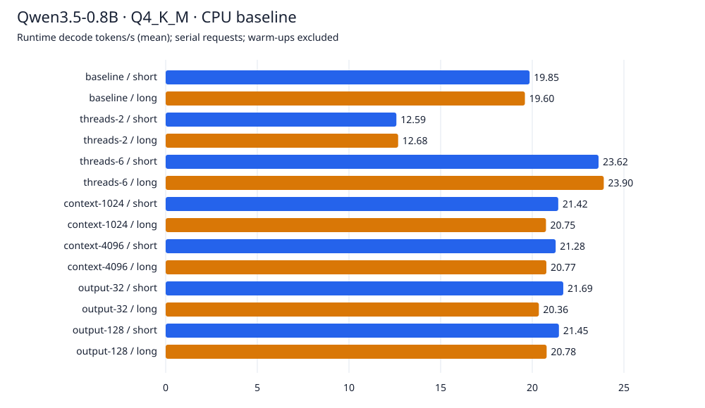

# Historical Qwen CPU baseline — 2026-10-21

> This is the original Qwen3.5-0.8B experiment, retained as historical evidence.
> None of its measurements describe the selected Llama 3.2 model. The current
> Llama baseline is recorded separately in the current benchmark guide. The
> environment and command details below describe the original run; current
> project commands use the `llama` Conda environment documented in the README.

Qwen3.5-0.8B Q4_K_M successfully served **56 streaming requests** in the recorded
experiment: 14 warm-ups and 42 measured requests. All completed with valid text,
token usage, timing fields, and `[DONE]`; every temporary server exited cleanly.

The baseline ran on **2026-10-21, 16:13:25–16:18:00 UTC** on the inspected VPS.
The recorded four-thread baseline decoded about 20 tokens/s. Six threads were
fastest among the tested settings, at about 24 tokens/s. These are serial CPU
measurements for this artifact and prompt set, not production capacity estimates.

## Preserved evidence

- [Complete raw experiment](../benchmarks/results/2026-10-21-baseline/raw.json)
- [Generated full summary table](../benchmarks/results/2026-10-21-baseline/summary.md)
- [Standalone decode-speed SVG](../benchmarks/results/2026-10-21-baseline/decode-speed.svg)
- [Historical prompts and experiment profiles](../benchmarks/configs/qwen-historical-baseline.json)
- [Historical runtime/model pins](../inference/qwen-historical-artifacts.lock.json)

The raw file includes the OS/CPU/memory snapshot, compiler/CMake/Python/HTTPX
versions, CMake cache, exact runtime commit and binary hash, model checksum and
GGUF metadata, source-file hashes, full prompts/settings, individual outputs,
warm-up labels, timings, process memory, startup times, and exit codes.

The native build reported `0.7.0-dev (build 1, commit 620d222)`. It is the pinned
v0.7.0 tag; the shallow clone's build number and source-build label are preserved
verbatim rather than presented as another upstream release identifier.

These machine-readable files preserve the original Qwen prompts, experiment
settings, runtime pin and outputs. The active runner now selects Llama, so these
Qwen inputs are historical records and must not be replayed through the current
model configuration or described as a fresh Llama measurement.

## Method: change one factor at a time

Each profile starts a fresh server with one inference slot. For each of two fixed
prompts, the script performs one warm-up and three measured requests. Warm-ups
load working data and exercise the path; they are stored but excluded from
summaries. All requests are serial, with no intentional competing inference load.

The **short** prompt asks for an explanation of CPU cache locality. It has 46
tokens after the runtime's template/tokenizer processing. The **long** prompt
includes a fixed explanatory passage and has 331 tokens. The texts are committed
in `benchmarks/configs/qwen-historical-baseline.json`; reported counts come from
the model server.

The reference profile is four threads, context 2,048, output cap 64. We separately
change threads to two/six, context capacity to 1,024/4,096, or output cap to
32/128. This gives seven profiles rather than a full cross-product of settings.

Settings held constant include:

- Exact model file and runtime commit; CPU-only Release/native build.
- One slot, generation/prefill thread counts equal within a profile.
- Batch 256, microbatch 128, CPU flash attention enabled, f16 attention K/V.
- Thinking disabled, no context shifting, zero context checkpoints/RAM prompt cache.
- `temperature=0`, `seed=42`, explicit `max_tokens`, SSE streaming with usage.
- `cache_prompt=false`: every one of the 56 requests recorded `cache_n=0`.

Disabling **prefix reuse** does not disable intra-request attention or recurrent
state. It ensures a repeated prompt still does prefill work instead of appearing
artificially fast because an earlier request already processed it.

`inference/server.py::ManagedServer` waits for readiness and reaps its owned
process on success or failure. No experiment server is deliberately left running.
Startup time is recorded separately and excluded from request TTFT/latency.
Observed startup times across the profiles ranged from 1.23 to 1.65 seconds.
They are not cold-disk measurements; earlier setup/testing already touched the
model, and the OS page cache was not flushed.

## Results

Each prompt/profile entry below contains three measured requests. TTFT is a
median; decode speed is the arithmetic mean of the runtime's reported speed.
RSS is the maximum observed process lifetime high-water mark for the profile.

| Profile | Threads | Context | Output cap | Short TTFT (s) | Long TTFT (s) | Short decode (tok/s) | Peak RSS (MiB) |
| --- | ---: | ---: | ---: | ---: | ---: | ---: | ---: |
| baseline | 4 | 2048 | 64 | 0.318 | 1.990 | 19.85 | 850.4 |
| threads-2 | 2 | 2048 | 64 | 0.512 | 3.560 | 12.59 | 845.8 |
| threads-6 | 6 | 2048 | 64 | 0.275 | 1.547 | 23.62 | 849.6 |
| context-1024 | 4 | 1024 | 64 | 0.315 | 1.900 | 21.42 | 838.1 |
| context-4096 | 4 | 4096 | 64 | 0.316 | 2.002 | 21.28 | 874.5 |
| output-32 | 4 | 2048 | 32 | 0.311 | 1.924 | 21.69 | 850.2 |
| output-128 | 4 | 2048 | 128 | 0.307 | 1.907 | 21.45 | 850.5 |

The [generated full table](../benchmarks/results/2026-10-21-baseline/summary.md)
also reports total request latency and the long-prompt decode rates.

### Threads

At 64 output tokens, six threads decoded 23.62/23.90 tokens/s for the short/long
prompts, compared with 19.85/19.60 at four and 12.59/12.68 at two. The data supports
six threads as the fastest **tested serial configuration**. We cannot infer
that extra threads beyond the six available vCPUs would help, or that six remains
best when the backend and other users compete for CPU time.

Keep the four-thread launcher default as a conservative initial allocation while
we add the application in later phases. In the historical Qwen run, six threads
were faster for dedicated serial inference; this needs a fresh Llama measurement
before changing the active default.

### Context and memory

Peak RSS increased from 838.1 MiB at context 1,024 to 850.4 MiB at 2,048 and
874.5 MiB at 4,096 with four threads. The file itself is 552.8 MiB; runtime state,
resident mapped weights, and working buffers account for additional memory.
All measured profiles remained below 875 MiB process RSS.

These prompts are only 46 and 331 input tokens. The context sweep changes
**allocated capacity**, not the number of input tokens. It shows a memory cost
for reserving more context; it does not measure full-window prefill, long-context
quality, or behavior when a 4K conversation actually fills the window.

The four-thread context profiles have somewhat higher decode rates than the
first baseline profile. Run order, VPS variability, and warm-up effects are
plausible explanations. The test is too small and not randomized; attributing
that difference to context capacity would be unwarranted.

### Output budget

With four threads and context 2,048, the short prompt's median latency grew from
1.752 seconds at cap 32 to 3.493 at 64 and 6.262 at 128. The long prompt grew from
3.453 to 5.265 to 7.947 seconds. TTFT changed much less because input processing
remained similar. This illustrates the sequential cost of decoding more output.

Every benchmark response hit its cap and ended with `finish_reason="length"`.
They are deliberately truncated performance workloads, not complete answer-quality
samples. A length finish is a valid protocol completion. A separate live test
verifies natural termination on a short arithmetic answer.

## Measurement definitions and limits

`benchmarks/scripts/metrics.py::stream_chat` measures from before HTTP submission
to the first non-empty text delta for TTFT, and to the end of the stream for total
latency. Role events/heartbeats do not count as visible output. It requires HTTP
success, SSE content type, valid JSON, usage, a finish reason, and `[DONE]`.
Runtime decode rate is copied from `timings.predicted_per_second`; it is not
estimated from chunk count. Raw `prompt_ms`, `predicted_ms`, and token counts
remain available, but should not be forced into a precise end-to-end latency
breakdown: the timing boundaries and first-token accounting differ.

`inference/server.py::memory_snapshot` reads Linux `VmRSS` and `VmHWM`. The latter
captures peak RSS over the process lifetime, including startup/warm-up; it cannot
identify exactly which request first caused a peak. These numbers exclude the
Python caller, other VPS processes, and machine-wide memory pressure. The VPS
has no swap; no memory exhaustion test was attempted.

Other limitations:

- Three repetitions per prompt/profile provide a baseline, not statistical
  confidence intervals, a meaningful p95, or an SLA.
- Profiles ran in a fixed order on shared virtual hardware. Host contention,
  CPU frequency, page residency, and cache state can vary between runs.
- No system cache flushes or disruptive host changes were used.
- Greedy sampling, two educational prompts, and one quantization do not establish
  general answer quality. The saved text contains ordinary small-model errors;
  even a correct arithmetic smoke answer is only a basic functionality check.
- Thinking, vision, cache quantization, concurrent users, scheduling/queueing,
  FastAPI overhead, and public-network latency have not been benchmarked.
- Native build settings and this particular quantizer's bytes matter. Results
  should not be generalized to other CPUs or similarly named GGUF artifacts.

## What to investigate next

Phase 2 will add a local FastAPI inference client and a minimal browser interface
that forwards the existing SSE stream. It does not begin until Phase 1 is reviewed.
Quantization comparisons, repeated/randomized tuning, cache experiments, and
concurrency studies belong to the authorized later optimization phase.

## Final verification

The original `ruff check .` and `ruff format --check .` passed. Ordinary tests
reported **40 passed, 7 intentional opt-in skips**. The full
`pytest --run-inference` run reported **47 passed, no skips, in 10.79 seconds**.
The full run includes a separate real-model benchmark smoke test. A final host
process check found no remaining `llama-server` processes.

Actual command outputs are preserved in
[verification.json](../benchmarks/results/2026-10-21-baseline/verification.json),
with [JUnit results](../benchmarks/results/2026-10-21-baseline/tests.xml).

These are the original 2026-10-21 test and performance results. Subsequent review
and test revisions are tracked separately in [project status](project-status.md)
and [historical testing contracts](qwen-testing-contracts-2026-10-24.md); they do not replace the original
raw measurements or their source hashes. Charts preserve valid zero decode rates,
which can occur when a workload produces only one token and has no subsequent
decode steps.

For the Phase 1 learning checkpoint and interview practice, see
[What You Should Understand After This Phase](01-inference-fundamentals.md#what-you-should-understand-after-this-phase).
