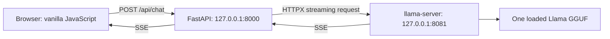

# 04 — FastAPI architecture

Phase 2 is authorized. Phase 1 was reviewed, audited, and committed as
`de5b6b5` (`Phase 1`). This phase adds a local stateless web application.

The backend never reads model weights or starts a model process. It creates one
shared HTTPX AsyncClient during application lifespan and closes it at shutdown.
Each generation owns and closes its upstream response. The browser's messages
are in memory; refreshing the page clears them. Persistence is Phase 3.

## Observable API contract

- `GET /` serves the chat page; `/static/` serves local CSS and JavaScript.
- `GET /health` returns `{"status":"ok"}` for backend liveness.
- `POST /api/chat` accepts JSON with `messages`, `max_tokens` (default 1024),
  `temperature` (default 0.7), `top_p` (default 0.9), and `seed` (default 42).
- Messages contain only `role` and `content`. Roles are user/assistant plus an
  optional initial system message. Require alternating user/assistant turns,
  ending with a user message. Maximum 16 messages; each nonblank content is at
  most 4,000 characters; total content at most 8,000 characters. Unknown fields
  and invalid types are rejected. These character limits do not approximate an
  exact token count; llama.cpp still enforces its context capacity.
- Generation limits: integer max_tokens 1–2048, finite temperature 0–2, finite
  top_p greater than 0 and at most 1, integer seed 0–2,147,483,647.
- Invalid request schema receives HTTP 422 and starts no upstream request.
- Valid requests receive HTTP 200 `text/event-stream`. Only the fixed model alias
  is sent upstream; requests always enable streaming and usage, with cross-request
  prompt reuse disabled. A client cannot supply an upstream URL or model name.
- The backend relays complete SSE events progressively, ending successful output
  with `data: [DONE]`. Role-only and usage events remain valid. It accepts fragmented
  UTF-8, CRLF, comments, and multiline data fields. Malformed JSON, oversized events
  (over 65,536 characters), or EOF without `[DONE]` are protocol errors.
- Runtime errors after streaming starts use `event: error` with JSON
  `{"error":{"code":"...","message":"..."}}`, followed by EOF, without a
  success terminator. Codes: `upstream_unavailable`, `upstream_timeout`,
  `upstream_rejected`, `upstream_error`, `upstream_protocol_error`. Messages are
  safe summaries; raw upstream bodies and internal exception strings are omitted.
  There is no automatic retry, since generation may already have begun.
  Upstream 400/413/422 map to `upstream_rejected`; 429/503 map to
  `upstream_unavailable`; other non-success statuses map to `upstream_error`.
- Default connect timeout 5 seconds, read-idle timeout 30 seconds, total request
  deadline 120 seconds. The total includes waiting for upstream headers and all
  streamed data, so a slowly dribbling response cannot run indefinitely.
  The upstream is closed before terminal error delivery. The response producer
  allows at most 100 ms beyond the total deadline to flush its terminal frame;
  every downstream send, including error and final empty-body sends, is bounded.
- Browser abort/disconnect cancels the upstream operation even before the first
  token. Closure is guaranteed on success, protocol/transport errors, timeouts,
  cancellation, and backend shutdown. This must hold for ASGI 2.3 and 2.4 scopes.

`backend.config.Settings` supplies validated environment configuration and allows
short test timeouts. `backend.app.create_app(settings=None, transport=None)` is
the application factory; its optional HTTPX transport is the mocked-network seam
for tests. `backend.inference` owns streaming and error translation. The existing
native runtime and benchmark modules keep their Phase 1 responsibilities.

## Local operations and scope

Start llama-server in one terminal and the backend in another. Both bind only
loopback. Remote testing uses SSH port forwarding to backend port 8000; the
browser needs no direct inference-server access. Explicit resource admission,
quotas, Caddy/HTTPS, database storage, and public exposure belong to later phases.

FastAPI, Uvicorn, and Pydantic are Conda packages. Node.js is a development-only
tool for dependency-free tests of the vanilla JavaScript parser and UI behavior;
there is no bundler, npm dependency, Node server, or frontend framework.
