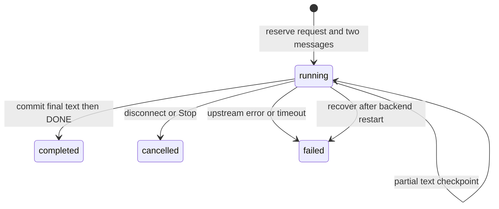

# 08 — Sessions and persistent chat

The browser holds a random 256-bit session cookie, and PostgreSQL stores only its
hash. It is HttpOnly, SameSite=Lax, scoped to `/api`, with a 30-day lifetime.
The prepared public HTTPS profile requires Secure=true; local HTTP uses Secure=false.
Losing the cookie loses access to that anonymous session; no accounts are added.

## Persistent API contract

- `POST /api/session` creates a session when the cookie is absent/invalid/expired,
  otherwise reuses the valid session. Response: status and expiry, without raw
  token/hash/credentials. Other persistent endpoints require a valid cookie (401).
- `POST /api/conversations`: optional title, default `New conversation`; returns
  id/title/timestamps. First prompt supplies a title when the default is retained.
- `GET /api/conversations?limit=20&offset=0`: owned conversations ordered newest
  update first, with `items`, `limit`, `offset`; limit 1–100, offset nonnegative.
- `GET /api/conversations/{id}?limit=100&before_position=N`: metadata plus latest
  messages in ascending position order, `active_request`, and `next_before_position`
  for older pages. Each message includes role/content/status/request_id/position.
- `PATCH /api/conversations/{id}`: replace title. `DELETE` removes owned history;
  deletion during active generation returns 409. Missing or other-owned IDs are
  uniformly 404. Ownership also applies to request metrics/history.
- `GET /api/conversations/{id}/requests?limit=100&offset=0`: paginated request
  state and measured usage/timing/error information, without internal credentials.
- `POST /api/conversations/{id}/chat`: JSON `content` plus max_tokens, temperature,
  top_p, seed with the existing generation limits (default output 1024, max2048).
  The client supplies no message history. The server builds it from completed
  persisted turns; failed/cancelled turns remain visible but are excluded from
  future model input. Existing 16-message/8000-character bounds still apply.
- A valid persisted request is committed before streaming starts. SSE includes
  metadata with request/conversation IDs and `queue_wait_seconds` (the measured
  monotonic admission interval), then ordinary text/usage events. Durable
  successful completion precedes `[DONE]`. Terminal errors use the existing safe
  SSE error contract; persistence failures use `persistence_error`.
- The earlier `/api/chat` remains a local-profile transient endpoint for compatibility
  and existing inference tests. It does not read or write saved conversations.
  The browser uses only the persistent endpoint. The public profile disables
  transient chat so it cannot bypass quotas and session ownership.
- With no database configured, transient inference remains available; persistent
  endpoints return safe 503 errors. There is no silent in-memory persistence fallback.

## Browser behavior

On page load, bootstrap the session, list conversations, and restore the newest
conversation (or create the first empty one). New Conversation creates and selects
a saved conversation; the selector restores its messages and state labels. Reload
must restore the cookie-owned history. Render all text literally with textContent.
Controls use IDs `new-conversation` and `conversations` alongside the existing chat
controls. Generation sends only new content and parameters, with same-origin
credentials. Stop still aborts Fetch; disconnect finalization stores cancelled
state and partial text. After a terminal event, refresh saved state. A request
still finalizing can briefly return 409; it must not overwrite another active turn.

Database integration tests exercise migrations, CRUD, owner isolation, transaction
rollback, successful/failed/cancelled/partial persistence, metrics, restart recovery,
and retention using a separate PostgreSQL database and mocked inference. Real-model
checks additionally require `--run-inference`. Ordinary tests keep both real
database and real model work opt-in and report their skips.

## Trace one turn

1. The browser establishes a session. A cryptographically random cookie acts as
   a bearer credential: whoever has it owns that anonymous history. The database
   stores its SHA-256 hash so a database read alone does not disclose the cookie.
2. A conversation belongs to the session's database ID. Every detail, rename,
   delete, request-history, and chat query checks this relationship; guessing a
   conversation UUID cannot bypass it.
3. The backend locks the conversation briefly and reserves the two messages and
   request in one transaction. It sends the existing completed context to the
   already-running native model. The browser cannot inject a different owner's
   saved history or select a model/URL.
4. Output arrives progressively. Checkpoints retain partial text; they do not
   yet make it a completed model turn. Stop closes the upstream connection and
   flushes the received partial text as cancelled.
5. Only a committed completed state permits the success terminator. Errors are
   failed requests with a safe code; restart recovery labels interrupted running
   rows `backend_restarted`. A DB outage may retain only the last checkpoint.



The SSE metadata contains identifiers, not session tokens. Request metrics include
backend TTFT (first visible model delta), latency through terminal handling, native
prompt/completion counts, and native decode tokens/second when supplied. TTFT is
measured before its database checkpoint and downstream network delivery; it is not
a browser paint measurement. Missing runtime usage remains null rather than an
invented zero. These records are not replacements for the controlled Phase 1
benchmark; database writes introduce different overhead.

## Try the persistent API

With both foreground services running and credentials loaded for the backend,
this uses a private cookie jar on your own terminal:

```bash
umask 077
curl -sS -c .runtime/chat-cookies.txt -X POST http://127.0.0.1:8000/api/session
curl -sS -b .runtime/chat-cookies.txt -H 'Content-Type: application/json' \
  -d '{"title":"Learning persistence"}' http://127.0.0.1:8000/api/conversations
```

Copy the returned conversation ID into `CONVERSATION_ID`:

```bash
CONVERSATION_ID=PASTE_THE_RETURNED_UUID
curl -N -b .runtime/chat-cookies.txt -H 'Content-Type: application/json' \
  -d '{"content":"What is a transaction?","max_tokens":64,"temperature":0}' \
  "http://127.0.0.1:8000/api/conversations/$CONVERSATION_ID/chat"
curl -sS -b .runtime/chat-cookies.txt \
  "http://127.0.0.1:8000/api/conversations/$CONVERSATION_ID"
curl -sS -b .runtime/chat-cookies.txt \
  "http://127.0.0.1:8000/api/conversations/$CONVERSATION_ID/requests"
```

Refresh the web page or restart only the backend to see persistence. Another
browser profile gets a different cookie and cannot retrieve this conversation.
HTTP 401 means the session is missing/expired; reload establishes a new anonymous
session. HTTP 409 means a previous request is still finalizing. HTTP 422 can mean
the completed history exceeds the existing input bounds; start a new conversation.
HTTP 503 means persistence is missing or unavailable before streaming begins.

## Limits of this milestone

The selector shows the most recent 20 conversations; the API supports pagination.
A conversation view fetches its latest 100 messages with an API cursor for older
pages. The UI has no rename/delete or older-page controls yet; these operations
are available through the owned API. Failed/cancelled messages remain saved even
when they make the visible log longer than the completed model context.

A crashed process can lose up to the most recent checkpoint interval of text
(and any text waiting on a failed DB write). Five seconds bounds terminal cleanup,
not a guarantee during an unresponsive DB. Recovery currently runs at backend
startup, so do not run multiple backend workers or overlapping backend instances.
Anonymous cookies are not account recovery: clearing browser data loses access.
The cookie is HttpOnly/SameSite=Lax and local HTTP deliberately uses Secure=false;
public HTTPS, full CSRF/security review, rate limits, backups, and admission
controls remain Phase 4. No public endpoint has been exposed.
