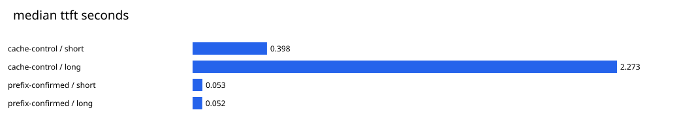
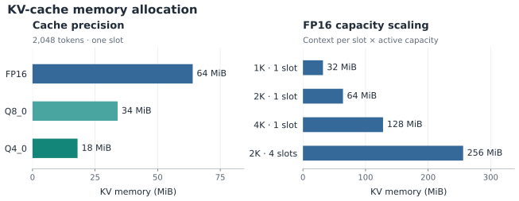

# Benchmark methodology and results

## Measurement rules

Use the existing pinned CPU llama.cpp and exact Llama 3.2 1B Instruct family.
Q8_0 is an additional verified experimental artifact, never a silent active-model
replacement. Preserve the active Q4 artifact. Record source,
filename, revision, SHA-256, size, GGUF architecture/tokenizer/template metadata,
and verify a live Q8 answer before comparison. No runtime rebuild is needed.

Native experiments use benchmark-only configuration, no changes to server
production defaults. One warm-up and at least three measured repeats per profile
and prompt. Fixed short/long prompts, temperature0, seed42, outputcap32 initially.
Change one variable per pair: Q4/Q8, threads2/4/6, context1024/2048/4096,
KVf16/q8_0/q4_0 when supported, batch/ubatch, flash attention on/off, and
cache_prompt false/true with a fixed repeated prefix. Record unsupported actual
configurations honestly rather than substituting them. A small fixed objective
quality set records prompts, expected answers, actual outputs and exact checks;
it is not an industry quality benchmark or broad model-intelligence claim.

Every report records the actual command/configuration, runtime/model/source pins,
hardware/load, timestamps, warm-up phase, per-request payload/output, native
usage/timings (including cache_n/prompt_n when provided), TTFT, end-to-end latency,
CPU process deltas, RSS/high-water memory, and server exit status. Persist partial
results on failures. Avoid overwriting results. Generate tables and standalone
charts from raw machine-readable measurements, excluding warm-ups.

## Cache and concurrency

Measure actual runtime cache allocation separately from process RSS. GQA logical
KV bytes use layers * context * KVheads * head_dimension * 2(K,V) * elementbytes;
quantized block overhead/alignment and runtime allocation require real evidence.
Repeated-prefix cache experiments include first uncached warm-up and cached
measured calls; do not describe warm reuse as cold prefill. Verify native cache
counters instead of inferring a hit solely from latency. Note cross-session
privacy concerns and leave application cache_prompt=false.

Native slot-concurrency experiments compare 1/2/4 clients, three waves each,
throughput, mean/median/p95 request latency, TTFT, CPU/memory and errors. Compare
serial native slots versus native continuous batching (e.g. four slots), with
constant per-slot context. This is an experiment, not a change to application
admission defaults.

Full stack experiments use temporary loopback certificate-verified HTTPS Caddy,
backend, isolated migrated *_test schema, and owned native server. Compare FIFO
one-active/two-waiters against immediate-reject one-active/zero-waiters with
1/2/4 simultaneous clients. Three measured waves after a separate warm-up,
unique conversations and generous test-only rate/quota limits. Save errors and
rejections as denominators, wall-clock throughput, latency/TTFT, queue wait
(measured server-side), process resource snapshots. Never benchmark against
application data. No CA installation, ACME, firewall or service changes.

Separate model prompt/decode timing only when supplied by native timing fields.
Any client-time-minus-runtime residual combines transport/framework/scheduling
and persistence overhead; it is not precise pure network time. Queue wait must
be a measured interval, not inferred from a latency difference. p95 on small
samples is descriptive, not a capacity guarantee. Report rejection rates over
all measured attempts, not successes only.

## Independent verification

Benchmark configuration validation, event/usage/counter collection, warm-up
exclusion, percentiles, failure recording, raw-result consistency, reports, and
cleanup need independent tests. Existing whole-stack opt-in HTTPS test must pass
along with ordinary and database/inference suites. Keep tests separate from the
actual performance measurements. Real experiments run serially to avoid mutual
CPU contention; tests must not run native servers during measured sweeps.

## Reproduce locally

Use the activated `llama` Conda environment, the existing pinned runtime, and
personally accepted model access. Additional Q8 bytes are experimental; the
application continues to select Q4. Choose fresh output names on each run.
The sweep can take several minutes on this CPU; let it finish before starting
another model process or the whole-stack suite.

```bash
python -m benchmarks.scripts.experiment_artifacts q4
python -m benchmarks.scripts.experiment_artifacts q8 --download
python -m benchmarks.scripts.experiments \
  --config benchmarks/configs/phase5-native.json \
  --output benchmarks/results/local/native-new.json
python -m benchmarks.scripts.experiments --probe-cache \
  --output benchmarks/results/local/allocation-new.json
python -m benchmarks.scripts.experiments \
  --config benchmarks/configs/phase5-prefix-confirmation.json \
  --output benchmarks/results/local/prefix-new.json
python -m benchmarks.scripts.report_experiments \
  benchmarks/results/local/native-new.json \
  --output-dir benchmarks/results/local/native-report-new
python -m benchmarks.scripts.report_experiments \
  benchmarks/results/local/prefix-new.json \
  --output-dir benchmarks/results/local/prefix-report-new
```

Cache probes use verbosity4 only for allocation evidence, without timed request
comparisons. The sweep uses ordinary verbosity and reports process RSS separately.
The hardened runner forces `cache_prompt=false` on each prompt's first warm-up,
then enables reuse only for the configured cached profile. The initial saved
sweep predates that correction for its long cache warm-up; the separate prefix
record verifies zero-cache warm-ups and positive measured cache counters.

For end-to-end measurements, provide a PostgreSQL test URL and a verified Caddy
binary (installed or staged only for testing). Caddy tests recognize
`LLAMA_TEST_CADDY` or an ignored staged binary. OpenSSL creates a
temporary certificate; the HTTPX client explicitly verifies it. All listeners
bind127.0.0.1 and all writes use a new isolated schema in the dedicated `_test`
database. No application migrations or data changes are required.

```bash
source .runtime/database.env
unset LLAMA_DATABASE_URL
python -m benchmarks.scripts.stack_experiment \
  --config benchmarks/configs/phase5-stack.json \
  --output benchmarks/results/local/stack-new.json
```

The stack JSON includes its summary; curated tables and standalone SVGs in the
saved run derive from those fields. No production rate/quota/admission default
is changed: the experimental backend receives generous test-only quotas and
queue settings. The fixed synthetic HTTPS requests stand in for a browser's API
requests; DOM painting and internet paths are not timed.

After all performance runs have stopped, verify the whole application:

```bash
ruff check .
ruff format --check .
pytest
pytest --run-database --run-inference
```

The ordinary suite does not load model weights or use PostgreSQL. When Caddy is
available it can start temporary loopback proxy tests. Database/native work stays
explicitly opt-in and missing dependencies fail an explicitly requested live run.
The current saved run is [2026-11-10-phase5](../benchmarks/results/2026-11-10-phase5/README.md).


## Performance findings and engineering decisions

These are real **2026-11-10 local measurements** on the six-vCPU Xeon Platinum
8272CL VPS, with 16GB RAM, no GPU, pinned llama.cpp and Meta Llama3.2 1B Instruct.
They are x86 CPU observations; NPU, mobile power draw, and GPU were not tested. The engineering contribution is reproducible investigation of
latency, memory, correctness, caching, and overload rather than a hardware claim.

The [curated experiment record](../benchmarks/results/2026-11-10-phase5/README.md)
links raw data, exact configurations, frozen source, tables and standalone charts.
The native sweep contains18 profiles and232 successful requests, including58
warm-ups and174 measured requests, plus16 separate quality outputs. The corrected
prefix pair adds16 requests plus8 quality outputs; it is not additional unique
quality coverage. Six separate startup probes record actual native KV allocation.
The HTTPS stack run contains56 attempts across24 waves:14 warm-up attempts and42
measured attempts. It records27 measured successes,15 expected admission rejections,
and zero other measured errors. All performance tests ran before the final test
suite, with no overlapping inference experiments.

## Weight quantization: smaller was faster here, not universally

Four threads,2048 tokens per slot, f16 KV, one client, temperature0, seed42 and
32 output tokens; each row has three measured repeats after a warm-up:

| Weights | GGUF MiB | Peak RSS MiB, long | Short TTFT s | Short decode tok/s | Long TTFT s | Long median latency s |
| --- | ---: | ---: | ---: | ---: | ---: | ---: |
| Q4_K_M |770.28|1366.5|0.421|21.19|2.279|3.935|
| Q8_0 |1259.88|1408.1|0.802|11.30|4.004|6.801|

TTFT/latency are medians; decode is the arithmetic mean of native decode rates.
Q8's file is63.6% larger, but its observed peak RSS is only about3.0% larger.
These are different measures. For example, the separate Q4 startup trace reports
a445.50MiB `CPU_REPACK` model buffer, beyond mapped GGUF storage, plus KV and
compute buffers. That illustrates runtime allocation overhead; it does not fully
attribute the entire Q4/Q8 RSS difference. RSS/high-water includes mapped/shared
pages and process allocations, not just model tensor bytes or exclusive RAM.

On the fixed eight-case objective set, Q4 passes**4/8** and Q8**5/8**. Both answer
addition, multiplication, extraction and simple logic correctly. Q8 additionally
answers the KiB question correctly. Both fail other cases, and sequence answers
hit the32-token cap while ignoring the requested concise format. This small
exact-match task checks correctness and instruction-following together. It is not
a statistically supported quality ranking, perplexity evaluation, or evidence
that either model is reliable for general advice. Raw prompts, patterns, outputs,
finish reasons and scores are retained. Keep the existing UI accuracy warning.

**Decision:** retain Q4_K_M as the active artifact. Q8's substantial speed cost
and small, narrow score difference do not justify changing this constrained demo.

## CPU settings and context: measure variability as well as averages

| Profile | Short median TTFT s | Short mean decode tok/s | Long median latency s | Long peak RSS MiB |
| --- | ---: | ---: | ---: | ---: |
|2 threads|0.808|13.06|7.328|1365.9|
|4 threads, initial control|0.421|21.19|3.935|1366.5|
|6 threads|0.316|25.09|3.284|1368.5|
|4 threads, final control|0.406|24.06|3.579|1366.5|
|1024 context,4 threads|0.449|22.31|3.691|1334.5|
|4096 context,4 threads|0.415|22.38|3.872|1430.5|

Six threads were fastest on the short prompt in this pass, but one long-prompt
sample fell to6.36 decode tokens/s and6.985 seconds total. The four-thread short
control changed from21.19 to24.06 tokens/s across the sweep, about13.5%. Cloud
contention, scheduling, warming and fixed run order can therefore confound small
improvements. Three repeats do not separate all those causes. Do not discard the
outlier or advertise six threads as a universal optimum.

Context capacity is not prompt length: these rows use the same51/310-token prompts
and32-token output budget. Increasing capacity1024→4096 raised long peak RSS by
96MiB, matching the separately measured f16 KV increase32→128MiB. It did not make
these fixed prompts three times longer. Longer actual prompts are a separate
prefill cost, illustrated by the short/long columns.

Batch64/ubatch32, batch256/ubatch128, batch512/ubatch256 and Flash Attention off/on
all ran successfully. Full tables include them; several differences are comparable
to control drift. Native supports CPU Flash Attention, and quantized V requires it.
No runtime rebuild, custom cache, BLAS switch or GPU optimization was introduced.

**Decision:** keep four threads and4096 default context as the tested application
settings. Deployment's prepared300% CPU ceiling was **not active** during these
experiments; repeat measurements under that ceiling before promising public
performance. The native four-thread runs consumed approximately four cores' time.

## KV precision and prefix reuse

At2048 tokens in one slot, the runtime actually reports64MiB f16,34MiB q8_0 and
18MiB q4_0 KV buffers. Four slots at2048 each require256MiB f16. These are measured
allocation lines, separate from logical estimates and process RSS. The initial
performance sweep's default verbosity omitted allocation lines; six dedicated
verbosity4 startup probes provide this evidence without changing timed runs.

Quantized caches reduced measured process RSS modestly, while long-prompt TTFT
was2.629/2.651 seconds for q8_0/q4_0 versus2.279 f16 in the initial control.
Decode rates varied, and no broad cache-precision quality test was performed.
Memory savings alone do not establish a net application improvement.

The fresh controlled prefix pair measured long median TTFT**2.273→0.052 seconds**.
Native counters confirm309 reused tokens and one newly evaluated token, versus
zero reused tokens in the control. Both prompt warm-ups have `cache_n=0`.
The initial sweep's long prefix warm-up reused30 shared chat-header tokens; that
original evidence is preserved and disclosed, while the corrected pair is the
published cache comparison. Warm-cache TTFT is not cold prefill performance.

**Decision:** retain f16 KV and `cache_prompt=false` in the application. Prefix
reuse is powerful for repeated prompts, but cross-session cache isolation,
real traffic hit rates, and output-quality effects require more work before
turning it on for anonymous users. 





## Throughput is different from per-user latency

At four clients on the short native workload, serial one-slot throughput was
17.82 output tokens/s with p95 latency7.284s. Four slots with continuous batching
reached31.31 tokens/s with p95 latency4.182s, but peak RSS rose from1355.8 to1568.4MiB
and per-slot context stayed2048 (total capacity increased fourfold). Disabling
continuous batching reduced throughput to27.64 tokens/s in that four-slot case.
These are synthetic unthrottled native experiments, not a new application setting.

The certificate-verified loopback HTTPS path exercised Caddy, FastAPI, PostgreSQL
and native inference. With four clients, the existing one-active/two-waiter FIFO
admission completed9/12 requests, rejected3/12, sustained18.19 tokens/s, and had
successful-request p95 latency5.474s. Immediate rejection completed3/12 and
rejected9/12, with p95 successful latency2.067s. Faster rejected requests are not
faster answers. Both strategies kept native work bounded; FIFO traded waiting
for more completed requests. Expected503 responses remain in the denominator.

For FIFO with one client, median observed latency was1.700s. Its three measured
native prompt times were344–462ms and decode times1272–1310ms. Subtracting queue
wait and those native durations leaves about44–47ms, combining TLS/HTTP,
framework, scheduling, persistence, and streaming. This is **not precise network
latency**, and browser painting/DOM rendering was not timed. Queue wait is an
actual backend monotonic interval exposed in SSE metadata, not a guessed residual.

**Decision:** retain one active application generation and two waiters. Native
batching is a measured candidate for a future workload, but changing application
concurrency would require revalidating quotas, fairness, memory, cancellation,
and deployment ceilings. 

## Limits and reproducibility

- One small fixed workload set, one VPS, fixed profile order, and three repeats;
  p95 with3/6/12 observations is descriptive and often the maximum observation.
- Page cache and mapped model memory were warm after startup/warm-up. These are
  not OS-cache-cold disk-load tests or hardware energy measurements.
- CPU is process user+system time, with100% equal to one logical CPU. Native
  concurrent CPU attribution is per wave, not per request. Stack CPU percentages
  are approximate: resource counters are read after collection/progress writes,
  slightly later than the worker-completion interval used for throughput. Raw
  sampling times are retained; exact counter-window extension is unknown.
- Process high-water RSS is cumulative within a profile. It is not exact
  per-request transient memory or whole-machine exclusive physical memory.
- The original native sweep ran from a frozen source snapshot. Later fixes harden
  schema validation, failure evidence, CPU bookkeeping, and cache warm-up controls;
  they do not alter its completed measurements. The corrected prefix run uses
  the updated code. Source hashes, frozen files and the correction record are
  retained; no original result was overwritten or recast as a later run.
- HTTPS is private loopback with a temporary client-trusted certificate. No ACME,
  internet latency, installed systemd ceiling, public exposure, Qualcomm hardware,
  or graphical browser automation was tested. The whole-stack automated suite
  separately verifies restart, persistence, cancellation, ownership, and failure.

See [local running](running.md) and [manual deployment](deployment.md).

